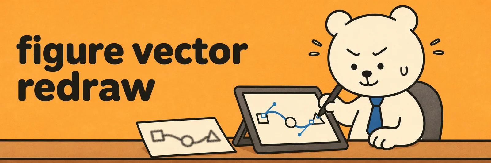

# figure-vector-redraw

[English](README.md) · **한국어**

과학 개념도를 편집 가능한 벡터로 다시 그리는 Claude 스킬 두 개와 보조 스크립트입니다. [figure-vector-redraw](SKILL.md)는 래스터 그림이나 AI 생성 그림의 과학적 내용을 점검하고 Claude Design에서 다시 그립니다. [figure-style-refine](style-refine/SKILL.md)은 요소를 정렬하고 여백과 스타일을 다듬으며, 사용자가 캔버스에서 직접 수정한 내용도 반영합니다.



논문 칼럼, 정사각형 패널, 세로형 포스터, 와이드 슬라이드 등 그림이 들어갈 곳에 맞춰 캔버스 크기를 정합니다. 원본 그림의 가로세로 비율을 유지할 수도 있습니다.

## 스킬 설치

- **Claude 앱**에서 [SKILL.md](SKILL.md)와 [style-refine/SKILL.md](style-refine/SKILL.md)를 각각 스킬로 추가합니다. 스킬은 필요할 때 이 저장소에서 스크립트를 내려받습니다.
- **Claude Code**에서는 저장소 루트를 `~/.claude/skills/figure-vector-redraw/`에, `style-refine/`의 내용을 `~/.claude/skills/figure-style-refine/`에 복사합니다.
- **로컬 도구**를 실행하려면 저장소 루트에서 Python과 Node.js 의존성을 설치합니다.

  ```sh
  python -m pip install -r requirements.txt -r style-refine/requirements.txt
  python -m playwright install chromium
  npm install
  npx playwright install chromium
  ```

## 작업 흐름

1. **과학적 내용을 점검합니다.** 빠지거나 중복된 라벨, 화살표 수, 표기법, 그림이 뒷받침하는 주장을 확인합니다. 반응 한 단계에 화살표가 하나인지, 대사 플럭스와 경로 활성이 구분되는지 등을 살핍니다.
2. **캔버스를 배치합니다.** 요청받은 가로·세로 크기나 최종 게재·발표 규격을 따릅니다. 내용에 맞게 패널 폭과 글자 크기를 정하고 실제 삽입 크기에서 읽히는지 확인합니다.
3. **그림 요소를 반영합니다.** 트레이스 SVG를 SVGO로 줄이고 업로드 한도에 맞게 나눈 뒤 순서대로 겹칩니다. 규칙적인 격자는 벡터로 다시 만들고, 잘린 도식 요소는 온전한 요소의 구조를 참고해 완성합니다.
4. **배경과 카드를 정리합니다.** 옅은 단색 바탕과 흰 카드를 출발점으로 쓸 수 있습니다. 장식은 별도 요소로 묶어 함께 수정하거나 제거할 수 있게 둡니다.
5. **완성본을 다듬습니다.** 제목·캡션·화살표를 정렬하고 여백을 조절합니다. 사용자가 캔버스에 남긴 수정과 코멘트도 반영합니다.
6. **실제 크기로 검토합니다.** 로컬 미리보기에서 잘림·겹침·정렬을 확인합니다. 보존 검사로 라벨과 도식 요소에 의도하지 않은 변화가 있었는지 살핍니다.

1200 × 1600 픽셀 세로형 아트보드를 미리 볼 때는 렌더링에도 같은 크기를 지정합니다.

```sh
python3 scripts/build_preview.py Artboard.dc.html preview.html --blob-map blobs.json
node scripts/render.js page preview.html preview.png --width 1200 --height 1600 --scale 2
```

Python 미리보기 도구 `style-refine/scripts/dc_preview.py`와 고리 라벨 도구 `style-refine/scripts/ring_label_gap.py`에도 같은 `--width`, `--height` 옵션을 쓸 수 있습니다.

## 보조 스크립트

| 파일 | 용도 |
| --- | --- |
| `scripts/svgo.config.cjs` | 마스크 ID와 경로 순서를 유지하며 트레이스 SVG를 줄입니다. |
| `scripts/svg_split.py`, `svg_merge.py` | 마스크를 유지해 SVG를 분할하고 최적화한 조각을 다시 합칩니다. |
| `scripts/svg_remove_boxes.py` | 경계 상자로 불필요한 도형을 제거하고 남은 후광을 마스크로 가립니다. |
| `scripts/grid_revectorize.py` | 격자 이미지를 연속한 사각형의 SVG 경로로 다시 만듭니다. |
| `scripts/measure_text.py`, `ring_labels.py` | Arial 메트릭으로 글자 폭을 재고 고리 도식의 라벨을 배치합니다. |
| `scripts/build_preview.py`, `render.js` | 독립 미리보기 HTML을 만들고 SVG·겹친 조각·페이지를 Chromium으로 렌더링합니다. |
| `style-refine/scripts/style_audit.py`, `preserve_check.py` | 스타일을 집계하고 전후 글자·도식 도형·도식 색·화살촉을 비교합니다. |
| `style-refine/scripts/swap_font.py`, `bump_text.py` | 글꼴을 적용해 넘침을 확인하고 기준점을 유지하며 역할별 글자 크기를 조절합니다. |
| `style-refine/scripts/effect_opacity.py`, `dc_preview.py` | 불투명도 후보와 로컬 에셋을 연결한 아트보드 미리보기를 만듭니다. |
| `style-refine/scripts/ring_label_gap.py`, `ring_arrows.py` | 고리와 라벨의 간격을 고르게 맞추고 같은 모양의 단계 화살표를 그립니다. |
| `style-refine/scripts/umap_spread.py` | 예시용 군집 모양을 유지하면서 위아래로 펼칩니다. |

## 참고

- 연구 그림 원본, 에셋과 데이터는 해당 연구 프로젝트에 보관합니다.
- `grid_revectorize.py --ramp`의 파생 지도와 `umap_spread.py --move`로 옮긴 군집은 예시용입니다. 분석에는 원래 측정값과 임베딩을 사용합니다.
- 스킬에 나오는 색상, 글자 크기와 패널 크기는 예시입니다. 실제 그림은 제출처 규격에 맞춥니다.
