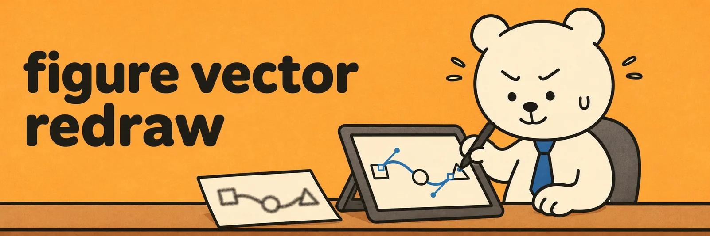

# figure-vector-redraw

**English** · [한국어](README.ko.md)

Two Claude skills and helper scripts for rebuilding scientific concept figures as editable vectors. [figure-vector-redraw](SKILL.md) checks a raster or AI-generated figure for scientific errors and redraws it in Claude Design. [figure-style-refine](style-refine/SKILL.md) aligns and polishes the editable figure, including changes the author made on the canvas.



Set the canvas size for the final use, such as a journal column, a square figure panel, a portrait poster, or a widescreen slide. The workflow can also keep the source figure's proportions.

## Install the skills

- **Claude app.** Add [SKILL.md](SKILL.md) and [style-refine/SKILL.md](style-refine/SKILL.md) as separate skills. They fetch scripts from this repository as needed.
- **Claude Code.** Copy the repository root to `~/.claude/skills/figure-vector-redraw/` and copy the contents of `style-refine/` to `~/.claude/skills/figure-style-refine/`.
- **Local helpers.** Install the Python and Node.js dependencies from the repository root.

  ```sh
  python -m pip install -r requirements.txt -r style-refine/requirements.txt
  python -m playwright install chromium
  npm install
  npx playwright install chromium
  ```

## Workflow

1. **Audit the science.** Check missing or duplicated labels, arrow counts, notation, and whether the figure supports its claims. For example, check that each reaction has one arrow and that the labels distinguish metabolic flux from pathway activity.
2. **Lay out the canvas.** Use the requested width and height or the final publication or presentation dimensions. Size panels and type for the content and check that the labels stay legible where the figure will be used.
3. **Bring in the artwork.** Optimize traced SVGs with SVGO. Split large assets to fit the upload limit and stack the pieces in order. Re-vectorize regular grids and rebuild clipped diagram elements using the intact elements as a reference.
4. **Set the background and cards.** A pale solid background with white cards is one starting point. Keep any decorative motif in a separate element so it can be edited or removed together.
5. **Refine the figure.** Align titles, captions and arrows, adjust spacing, and build on the author's edits and comments on the canvas.
6. **Review at the actual size.** Look for clipping, overlap and inconsistent alignment in local previews. Use the preservation check to catch unintended changes to labels and diagram elements.

For a portrait artboard of 1200 × 1600 pixels, build and render a local preview with the same dimensions.

```sh
python3 scripts/build_preview.py Artboard.dc.html preview.html --blob-map blobs.json
node scripts/render.js page preview.html preview.png --width 1200 --height 1600 --scale 2
```

The Python preview tool, `style-refine/scripts/dc_preview.py`, and the ring label tool, `style-refine/scripts/ring_label_gap.py`, accept the same `--width` and `--height` options.

## Helper scripts

| File | Purpose |
| --- | --- |
| `scripts/svgo.config.cjs` | Optimize traced SVGs while preserving mask IDs and path order. |
| `scripts/svg_split.py`, `svg_merge.py` | Split traced SVGs with their masks intact, then merge optimized pieces. |
| `scripts/svg_remove_boxes.py` | Remove unwanted shapes by bounding box and mask any remaining halo. |
| `scripts/grid_revectorize.py` | Rebuild grid images as SVG paths made of runs of rectangles. |
| `scripts/measure_text.py`, `ring_labels.py` | Measure text using Arial metrics and place labels around a ring diagram. |
| `scripts/build_preview.py`, `render.js` | Build a standalone preview and render SVGs, stacked layers and pages with Chromium. |
| `style-refine/scripts/style_audit.py`, `preserve_check.py` | Inventory styles and compare text, diagram shapes, diagram colors and arrowheads before and after editing. |
| `style-refine/scripts/swap_font.py`, `bump_text.py` | Apply a font, measure text overflow and resize text by role while keeping its anchor. |
| `style-refine/scripts/effect_opacity.py`, `dc_preview.py` | Preview opacity variants and render a Design artboard with local assets. |
| `style-refine/scripts/ring_label_gap.py`, `ring_arrows.py` | Set even spacing between a ring and its labels and draw consistent cycle arrows. |
| `style-refine/scripts/umap_spread.py` | Spread illustrative clusters vertically while preserving their shapes. |

## Notes

- Keep original research figures, artwork and data in the project where they belong.
- Derived maps from `grid_revectorize.py --ramp` and moved clusters from `umap_spread.py --move` are illustrations. Use the original measurements or embeddings for analysis.
- Treat the example colors, typography and panel sizes in the skills as starting points. Check the target venue's figure requirements.
